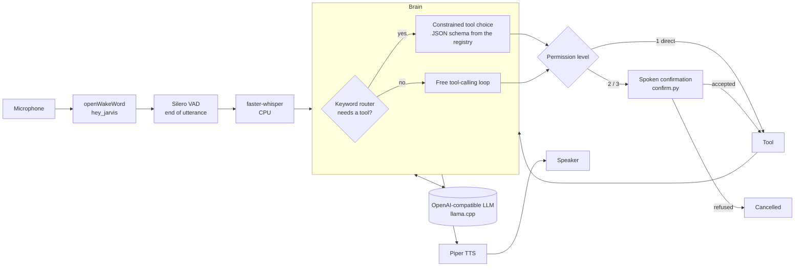

# Jarvis

*[English version](README.md)*

Un assistant vocal en français, 100 % local, pour un bureau Linux : mot d'éveil, reconnaissance vocale, un LLM
local qui choisit ses outils au travers d'une grammaire JSON, et un système de permissions à trois niveaux pour
tout ce qui a un effet sur la machine.


*La démo texte (`python -m jarvis --text`) : faux routeur LLM, outils factices, mais vraie logique de permissions
et de confirmation. L'assistant parle français exprès ; le code et la documentation sont en anglais.*

## Pourquoi ce projet

Les assistants dans le cloud envoient chaque phrase prononcée sur le serveur de quelqu'un d'autre, et les petits
modèles locaux sont peu fiables quand ils appellent des outils : ils répondent « de mémoire », inventent des
actions ou tournent en boucle. Ce projet est ma réponse personnelle à ces deux problèmes, pour un bureau
Hyprland :

- tout tourne sur la machine (la seule requête sortante est la météo Open-Meteo, facultative) ;
- le choix de l'outil est **contraint par un schéma JSON** (`response_format` de llama.cpp) : le modèle ne peut
  produire qu'un `{"tool": ..., "args": ...}` valide pour un outil enregistré, ou une réponse simple ;
- les actions qui peuvent faire du dégât (verrouiller la session, éteindre) demandent une **confirmation à voix
  haute**, et la lecture de cette confirmation est volontairement stricte : une négation l'emporte toujours sur
  un oui.

Il s'inspire de l'architecture de [sosoj92/jarvis-assistant-vocal](https://github.com/sosoj92/jarvis-assistant-vocal)
(registre d'outils, niveaux de permission, routeur devant le LLM), réécrite pour Linux et Hyprland.

## Fonctions

- Mot d'éveil (« hey jarvis », openWakeWord) ou raccourci clavier ; questions de suivi sans répéter le mot
  d'éveil.
- Silero VAD pour détecter la fin de phrase, faster-whisper (CPU, `large-v3-turbo` int8) pour la transcription
  en français.
- Routeur par mots-clés : les demandes qui ont besoin de données en direct ou d'une action passent forcément par
  l'étape d'outil contrainte par la grammaire.
- Registre d'outils à 3 niveaux de permission (tableau plus bas) ; aucun outil ne lance une commande shell libre.
- Synthèse vocale Piper, phrase par phrase, interruptible.
- Fonctionne avec n'importe quel serveur compatible OpenAI qui gère les formats de réponse `json_schema` ;
  point de repli facultatif quand le routeur llama.cpp principal est injoignable ou occupé par un gros modèle.
- Plugin facultatif : transmettre une demande à un agent distant par un petit contrat HTTP (désactivé par
  défaut).
- **Démo texte** avec un faux LLM et des outils factices : ni micro, ni GPU, ni modèle, ni clé d'API.

## Architecture



En mode démo, le micro, la reconnaissance et la synthèse vocales sont remplacés par une invite texte, et le LLM
par `jarvis/fake_llm.py` ; le cerveau, le routeur, la construction du schéma, les permissions et la confirmation
sont le même code.

## Démarrage rapide

D'abord la démo (Python 3.11 ou plus, aucune bibliothèque audio nécessaire) :

```bash
git clone <this repo> && cd jarvis
python -m venv .venv && . .venv/bin/activate
pip install -e .
python -m jarvis --text          # or: jarvis-demo
```

Essayez `quelle heure est-il ?`, `quel temps demain à Lyon ?`, `mets le volume à 30`,
`note que le dentiste est jeudi`, `verrouille la session` (répondez `oui`), `éteins le PC` (un simple `oui` est
refusé, `oui, je confirme` est accepté). La musique, le volume, les applications, le verrouillage et l'extinction
s'affichent sous la forme `[demo] would run: ...` et ne sont jamais exécutés ; la météo est simulée ; les notes
et les tâches vont dans un dossier temporaire.

Brancher la démo sur un vrai serveur (les outils restent factices tant qu'on n'ajoute pas `--real-tools`) :

```bash
JARVIS_LLM_URL=http://127.0.0.1:8080/v1 JARVIS_LLM_MODEL=my-model python -m jarvis --text
```

Le démon vocal (Linux, PipeWire/PortAudio, une voix Piper et un serveur LLM sont nécessaires) :

```bash
pip install -e '.[voice]'
python -c "import openwakeword.utils as u; u.download_models()"    # wake word models
# download a French voice, e.g. fr_FR-tom-medium.onnx + .json from the rhasspy/piper-voices repository
# on Hugging Face, into ~/.local/share/piper/
python -m jarvis
jarvis-ctl listen | stop | mute | unmute | toggle-mute | say <text> | ask <text>   # bind these to hotkeys
```

`systemd/jarvis.service` est un modèle d'unité utilisateur. Le démon écrit son état dans
`$XDG_RUNTIME_DIR/jarvis/state.json`, pour qu'une barre d'état ou un panneau puisse l'afficher, et ajoute chaque
échange à `$XDG_STATE_HOME/jarvis/history.jsonl`.

## Outils et permissions

| Niveau | Comportement | Outils |
|---|---|---|
| 1 | exécuté directement | heure, météo, contrôle des médias (playerctl), volume (wpctl), ouvrir une application (entrées `.desktop` installées uniquement), espace de travail, minuteur / rappel, état du système, prendre une note |
| 2 | « Tu confirmes ? » puis un oui explicite | ajouter une tâche, verrouiller la session |
| 3 | « Confirme en disant oui, je confirme » : un oui **et** le mot « confirme » | éteindre / redémarrer / mettre en veille |

Les outils d'action rapportent leur résultat exact ; les outils d'information (heure, météo, état du système,
lecture en cours) passent une fois par le LLM pour être dits naturellement, avec la consigne de ne pas modifier
les chiffres.

`confirm.py` normalise les accents et les apostrophes, et **la négation l'emporte toujours** : « pas d'accord »,
« non vas-y », « oui mais pas maintenant », « ne l'envoie pas » sont tous des refus. Tout ce qui n'est pas un
oui explicite est un refus.

## Configuration

Les valeurs par défaut sont dans `jarvis/config.py` ; on les remplace avec `~/.config/jarvis/config.toml` (ou
`$JARVIS_CONFIG`, voir `config.example.toml`) et des variables d'environnement (voir `.env.example`).

| Réglage | Défaut | Variable |
|---|---|---|
| `llm.url` / `llm.model` | `http://127.0.0.1:8080/v1` / `local` | `JARVIS_LLM_URL`, `JARVIS_LLM_MODEL` |
| `llm.api_key` ou `llm.key_file` | vide | `JARVIS_LLM_KEY` |
| `llm.fallback_url`, `llm.busy_models` | désactivés | |
| `llm.disable_thinking` | `true` (pas de phase de réflexion, pour la latence) | |
| `stt.model`, `stt.device` | `large-v3-turbo`, `cpu` | |
| `tts.voice` | `~/.local/share/piper/fr_FR-tom-medium.onnx` | `JARVIS_TTS_VOICE` |
| `wake.threshold`, `wake.patience` | `0.5`, `2` trames consécutives | |
| `weather.city/lat/lon` | Paris | |
| `notes.dir` | `~/Documents/jarvis-notes` | `JARVIS_NOTES_DIR` |
| `desktop.lock_command`, `desktop.workspace_command` | `loginctl lock-session`, `hyprctl dispatch workspace` | |
| `plugins.remote_agent.*` | désactivé | `JARVIS_REMOTE_KEY` |

## Tests

```bash
pip install -e '.[dev]'
ruff check .
pytest -q
```

Les tests n'ont besoin ni de micro, ni de GPU, ni de réseau, ni de bibliothèque audio. Ils couvrent le routeur
par mots-clés, le schéma JSON construit à partir du registre d'outils (et la sortie du faux backend validée
contre ce schéma avec `jsonschema`), les niveaux de permission, `confirm.py` (dont la priorité de la négation et
la règle du niveau 3), des tours complets du cerveau (un outil de niveau 2 ou 3 refusé ne s'exécute jamais, que ce
soit par le chemin contraint ou par la boucle d'outils libre), la boîte à outils factice (modifiée pour que tout
appel de sous-processus fasse échouer le test), la REPL de démo, la priorité des réglages et le plugin d'agent
distant face à un faux serveur HTTP local. Un test vérifie que `--text` n'importe aucune dépendance audio.

## Organisation du projet

```
jarvis/
  __main__.py   CLI: voice daemon, or --text demo
  daemon.py     wake word -> listen -> brain -> speak loop, control socket
  brain.py      turns, constrained tool choice (build_action_schema), permission gating
  router.py     keyword router (does this request need a tool?)
  tools.py      tool registry and implementations, permission levels
  confirm.py    yes / no / unclear parsing, level 2 and 3 acceptance rules
  llm.py        HTTP backend for OpenAI-compatible servers
  fake_llm.py   offline keyword/regex backend with the same JSON shapes (demo, tests)
  demo.py       text REPL and the stub toolbox
  plugins.py    optional tool plugins (remote agent), disabled by default
  audio.py, speech.py   microphone, wake word, VAD, Whisper, Piper (`voice` extra)
  config.py, state.py, textutil.py, ctl.py
tests/  systemd/  config.example.toml  docs/
```

## État et limites

- Projet personnel, développé sur une seule machine (Arch Linux, Hyprland, PipeWire). Pas de paquet pour
  d'autres distributions.
- Le choix d'outil contraint par la grammaire a été mesuré sur ma machine avec un modèle Qwen 9B local :
  36 outils corrects sur 36, en 3 passages de 12 demandes, avec 1,1 s de latence moyenne pour l'étape LLM. Le
  script de mesure ne fait pas partie de ce dépôt : prenez ce chiffre comme une observation, pas comme un
  résultat reproductible.
- La chaîne vocale (micro, mot d'éveil, Whisper, Piper) n'est couverte ni par les tests ni par la CI ; elle n'a
  été vérifiée qu'à la main. Le faux LLM de la démo est un routeur par mots-clés qui ne comprend que les phrases
  de `jarvis/fake_llm.py`.
- Le modèle de mot d'éveil `hey_jarvis` est anglais : il se déclenche moins bien avec un accent français ; le
  réglage `patience` échange un peu de réactivité contre moins de faux déclenchements (par exemple à cause de la
  télévision).
- Whisper peut halluciner sur du bruit ; un petit filtre écarte les phrases de sous-titres habituelles.
- Pas d'annulation d'écho : on ne peut pas interrompre Jarvis à la voix pendant qu'il parle (il faut le raccourci
  clavier).
- La météo passe par l'API publique Open-Meteo ; tout le reste reste sur la machine.
- Construit avec des assistants de code IA (Claude Code), comme on utiliserait Stack Overflow ou les pages de
  manuel ; les choix de conception décrits ici sont les miens et je peux les expliquer.

## Licence

MIT, voir [LICENSE](LICENSE).
