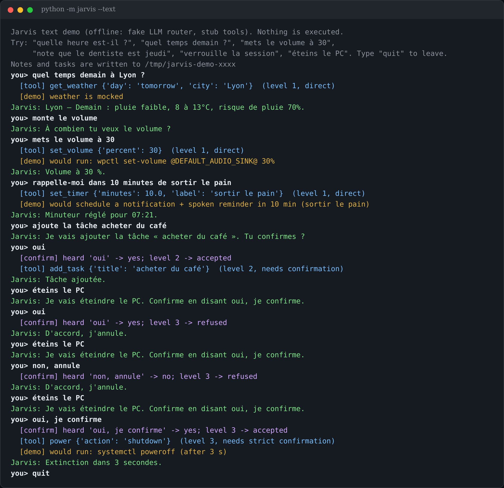
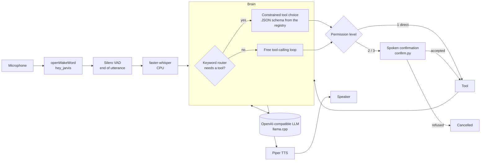

# Jarvis

A 100 % local, French-speaking voice assistant for a Linux desktop: wake word, speech-to-text, a local LLM that
picks tools through a JSON grammar, and a three-level permission system for anything with side effects.



*The text demo (`python -m jarvis --text`): fake LLM router, stub tools, real permission and confirmation logic.
The assistant speaks French on purpose; code and docs are in English.*

## Why it exists

Cloud assistants send every sentence you say to someone else's server, and small local models are unreliable
when they call tools: they answer "from memory", invent actions, or loop. This project is a personal answer to
both problems for a Hyprland desktop:

- everything runs on the machine (the only outgoing request is the optional Open-Meteo weather lookup);
- the choice of tool is **constrained by a JSON schema** (llama.cpp `response_format`), so the model can only
  output a valid `{"tool": ..., "args": ...}` for a registered tool, or a plain answer;
- actions that can hurt (lock the session, power off) need a **spoken confirmation**, and confirmation parsing is
  deliberately strict: a negation always wins over a yes.

It is inspired by the architecture of [sosoj92/jarvis-assistant-vocal](https://github.com/sosoj92/jarvis-assistant-vocal)
(tool registry, permission levels, router in front of the LLM), rewritten for Linux/Hyprland.

## Features

- Wake word ("hey jarvis", openWakeWord) or a hotkey; follow-up questions without repeating the wake word.
- Silero VAD for end-of-utterance, faster-whisper (CPU, `large-v3-turbo` int8) for French transcription.
- Keyword router: requests that need live data or an action are forced through the grammar-constrained tool step.
- Tool registry with 3 permission levels (table below); no tool runs a free-form shell command.
- Piper TTS, sentence by sentence, interruptible.
- Works with any OpenAI-compatible server that supports `json_schema` response formats; optional fallback
  endpoint when the primary llama.cpp router is unreachable or busy with a big model.
- Optional plugin: forward a request to a remote agent over a tiny HTTP contract (off by default).
- **Text demo** with a fake LLM and stub tools: no microphone, GPU, model or API key needed.

## Architecture



In demo mode the microphone/STT/TTS boxes are replaced by a text prompt and the LLM by `jarvis/fake_llm.py`;
the brain, router, schema building, permissions and confirmation are the same code.

## Quick start

Demo first (Python 3.11+, no audio libraries needed):

```bash
git clone <this repo> && cd jarvis
python -m venv .venv && . .venv/bin/activate
pip install -e .
python -m jarvis --text          # or: jarvis-demo
```

Try `quelle heure est-il ?`, `quel temps demain à Lyon ?`, `mets le volume à 30`, `note que le dentiste est jeudi`,
`verrouille la session` (answer `oui`), `éteins le PC` (a plain `oui` is refused, `oui, je confirme` is accepted).
Music, volume, apps, lock and power are printed as `[demo] would run: ...` and never executed; weather is mocked;
notes and tasks go to a temporary directory.

Point the demo at a real server (the tools stay stubbed unless you add `--real-tools`):

```bash
JARVIS_LLM_URL=http://127.0.0.1:8080/v1 JARVIS_LLM_MODEL=my-model python -m jarvis --text
```

The voice daemon (Linux, PipeWire/PortAudio, a Piper voice and an LLM server are required):

```bash
pip install -e '.[voice]'
python -c "import openwakeword.utils as u; u.download_models()"    # wake word models
# download a French voice, e.g. fr_FR-tom-medium.onnx + .json from the rhasspy/piper-voices repository
# on Hugging Face, into ~/.local/share/piper/
python -m jarvis
jarvis-ctl listen | stop | mute | unmute | toggle-mute | say <text> | ask <text>   # bind these to hotkeys
```

`systemd/jarvis.service` is a user unit template. The daemon writes its state to
`$XDG_RUNTIME_DIR/jarvis/state.json` so a status bar or panel can display it, and appends each exchange to
`$XDG_STATE_HOME/jarvis/history.jsonl`.

## Tools and permissions

| Level | Behaviour | Tools |
|---|---|---|
| 1 | runs directly | time, weather, media control (playerctl), volume (wpctl), open an app (installed `.desktop` entries only), workspace, timer/reminder, system status, take a note |
| 2 | "Tu confirmes ?" then an explicit yes | add a task, lock the session |
| 3 | "Confirme en disant oui, je confirme": a yes **and** the word "confirme" | power off / reboot / suspend |

Action tools report their exact result; information tools (time, weather, system status, now playing) get one
short LLM pass to be said naturally, instructed not to change the figures.

`confirm.py` normalises accents and apostrophes, and **negation always wins**: "pas d'accord", "non vas-y",
"oui mais pas maintenant", "ne l'envoie pas" are all refusals. Anything that is not an explicit yes is a refusal.

## Configuration

Defaults are in `jarvis/config.py`; override with `~/.config/jarvis/config.toml` (or `$JARVIS_CONFIG`, see
`config.example.toml`) and environment variables (see `.env.example`).

| Setting | Default | Env |
|---|---|---|
| `llm.url` / `llm.model` | `http://127.0.0.1:8080/v1` / `local` | `JARVIS_LLM_URL`, `JARVIS_LLM_MODEL` |
| `llm.api_key` or `llm.key_file` | empty | `JARVIS_LLM_KEY` |
| `llm.fallback_url`, `llm.busy_models` | disabled | |
| `llm.disable_thinking` | `true` (no reasoning phase, for latency) | |
| `stt.model`, `stt.device` | `large-v3-turbo`, `cpu` | |
| `tts.voice` | `~/.local/share/piper/fr_FR-tom-medium.onnx` | `JARVIS_TTS_VOICE` |
| `wake.threshold`, `wake.patience` | `0.5`, `2` consecutive frames | |
| `weather.city/lat/lon` | Paris | |
| `notes.dir` | `~/Documents/jarvis-notes` | `JARVIS_NOTES_DIR` |
| `desktop.lock_command`, `desktop.workspace_command` | `loginctl lock-session`, `hyprctl dispatch workspace` | |
| `plugins.remote_agent.*` | disabled | `JARVIS_REMOTE_KEY` |

## Tests

```bash
pip install -e '.[dev]'
ruff check .
pytest -q
```

The tests need no microphone, GPU, network or audio library. They cover the keyword router, the JSON schema built
from the tool registry (and the fake backend's output validated against it with `jsonschema`), permission levels,
`confirm.py` (including negation priority and the level 3 rule), brain turns end to end (a refused level 2/3 tool
never runs, in both the constrained path and the free tool loop), the stub toolbox (patched so that any
subprocess call fails the test), the demo REPL, config precedence, and the remote-agent plugin against a local
fake HTTP server. One test checks that `--text` does not import any audio dependency.

## Project layout

```
jarvis/
  __main__.py   CLI: voice daemon, or --text demo
  daemon.py     wake word -> listen -> brain -> speak loop, control socket
  brain.py      turns, constrained tool choice (build_action_schema), permission gating
  router.py     keyword router (does this request need a tool?)
  tools.py      tool registry and implementations, permission levels
  confirm.py    yes / no / unclear parsing, level 2 and 3 acceptance rules
  llm.py        HTTP backend for OpenAI-compatible servers
  fake_llm.py   offline keyword/regex backend with the same JSON shapes (demo, tests)
  demo.py       text REPL and the stub toolbox
  plugins.py    optional tool plugins (remote agent), disabled by default
  audio.py, speech.py   microphone, wake word, VAD, Whisper, Piper (`voice` extra)
  config.py, state.py, textutil.py, ctl.py
tests/  systemd/  config.example.toml  docs/
```

## Status / limits

- Personal project, developed on one machine (Arch Linux, Hyprland, PipeWire). Not packaged for other distros.
- The grammar-constrained tool choice was measured on the author's machine with a local Qwen 9B model: 36/36
  correct tools over 3 runs of 12 requests, 1.1 s mean latency for the LLM step. That benchmark script is not
  part of this repository, so treat the figure as an anecdote rather than a reproducible result.
- The voice pipeline (microphone, wake word, Whisper, Piper) is not exercised by the tests or by CI; it was
  only checked manually. The demo's fake LLM is a keyword router that only understands the phrases in
  `jarvis/fake_llm.py`.
- The wake word model `hey_jarvis` is English, so it triggers less reliably on a French accent; the
  `patience` setting trades responsiveness for fewer false triggers (for example from a TV).
- Whisper can hallucinate on noise; a small filter drops the usual subtitle phrases.
- No echo cancellation: you cannot interrupt Jarvis by voice while it speaks (use the hotkey).
- Weather uses the public Open-Meteo API; everything else stays on the machine.
- Built with AI coding assistants (Claude Code), used the way one would use Stack Overflow or man pages; the
  design choices above are the author's and can be explained.

## Licence

MIT, see [LICENSE](LICENSE).
